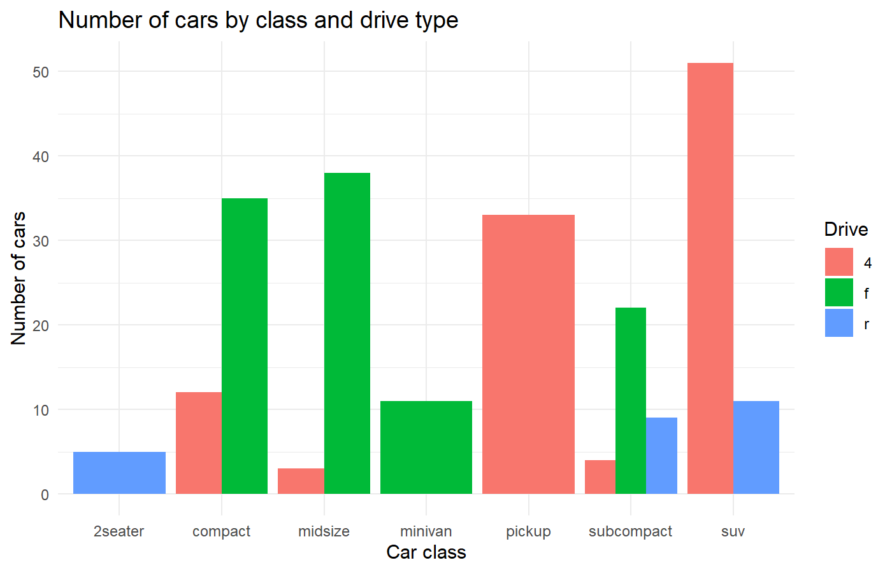
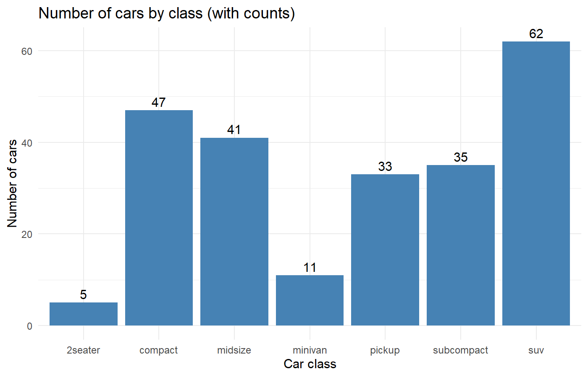
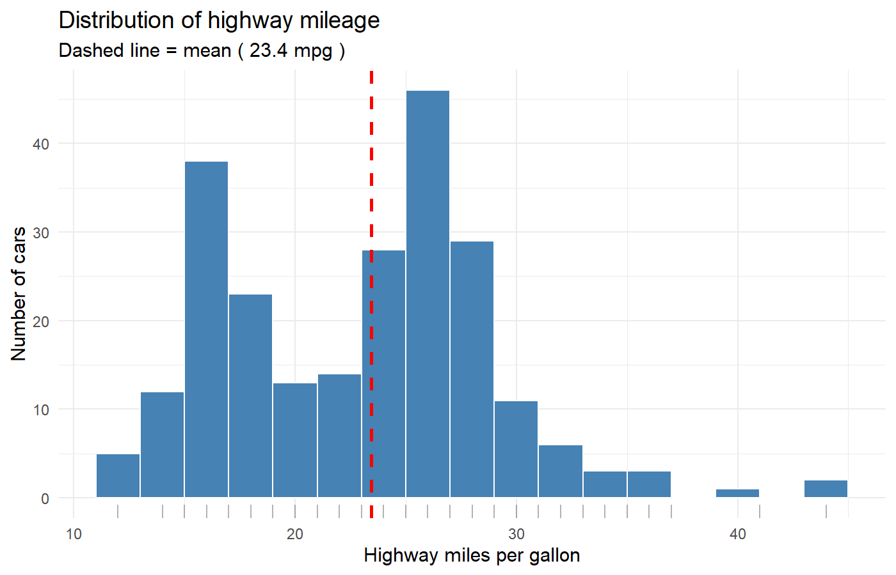
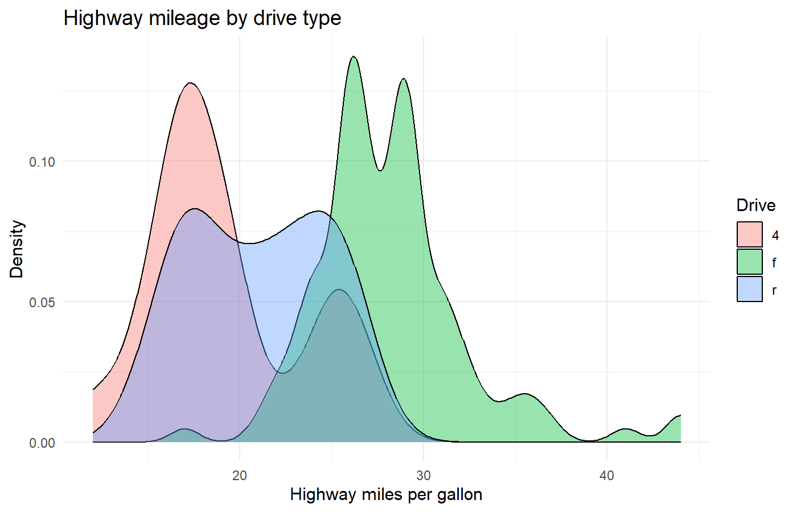
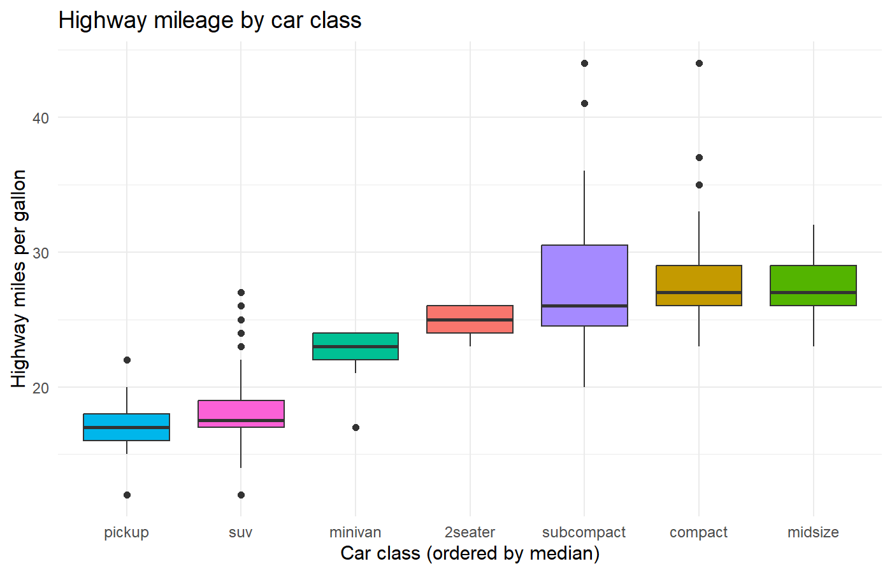
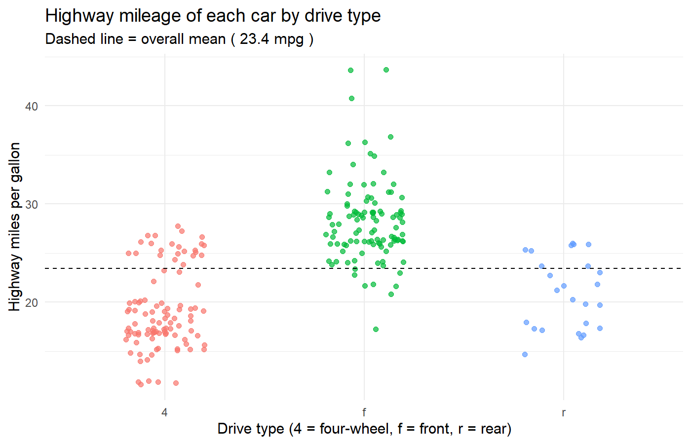
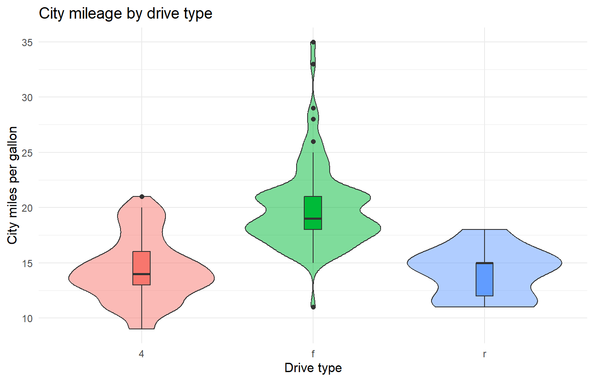
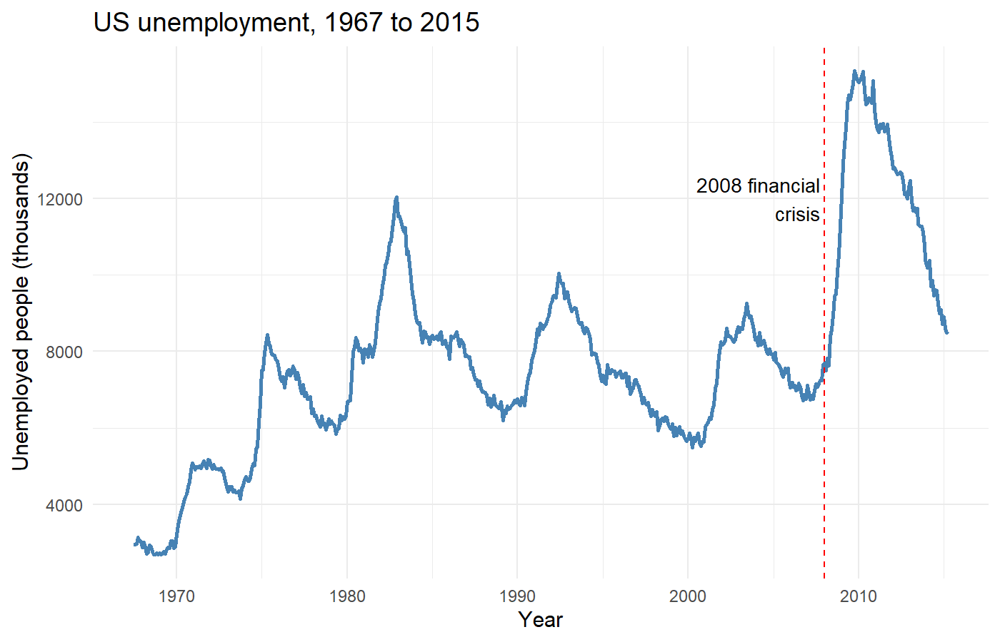

## Assignment 2: Data Visualisation with ggplot2 Geoms

**Script:** `HW2_ggplot.R`

### Objective

Use the following `ggplot2` functions to build and interpret plots in R:

`geom_bar()`, `geom_boxplot()`, `geom_density()`, `geom_histogram()`, `geom_hline()`, `geom_jitter()`, `geom_line()`, `geom_rug()`, `geom_text()`, `geom_violin()`, `geom_vline()`

### Data

Built-in datasets, so no files or internet connection are needed.

| Dataset | Package | Description |
|---|---|---|
| `mpg` | ggplot2 | fuel economy of 234 cars: `class`, `drv` (drive type), `hwy` and `cty` (highway and city miles per gallon) |
| `economics` | ggplot2 | US monthly economic data, 1967 to 2015: `date`, `unemploy` (thousands of unemployed people) |

### Which geom is used where

| # | Plot | Geoms | Variables |
|---|---|---|---|
| 1 | Number of cars by class and drive type | `geom_bar()` | `class`, `drv` |
| 2 | Number of cars by class, with counts | `geom_bar()` + `geom_text()` | `class` |
| 3 | Distribution of highway mileage | `geom_histogram()` + `geom_rug()` + `geom_vline()` | `hwy` |
| 4 | Highway mileage by drive type | `geom_density()` | `hwy`, `drv` |
| 5 | Highway mileage by car class | `geom_boxplot()` | `hwy`, `class` |
| 6 | Highway mileage of each car | `geom_jitter()` + `geom_hline()` | `hwy`, `drv` |
| 7 | City mileage by drive type | `geom_violin()` | `cty`, `drv` |
| 8 | US unemployment over time | `geom_line()` + `geom_vline()` + `geom_text()` | `date`, `unemploy` |

### How to run

1. open `HW2_ggplot.R`.
2. Run the script from top to bottom. It installs `ggplot2` if it is missing, draws the eight plots and saves each one in the `images/` folder.

### Plots

#### 1. `geom_bar()`: cars by class and drive type

SUVs are the most common class (62 cars). Pickups are all four-wheel drive, while minivans are all front-wheel drive.

#### 2. `geom_bar()` + `geom_text()`: counts on the bars

`geom_text(stat = "count")` prints the number of cars above each bar.

#### 3. `geom_histogram()` + `geom_rug()` + `geom_vline()`: highway mileage

The dashed line marks the mean highway mileage of about 23.4 miles per gallon. The rug marks show each individual car.

#### 4. `geom_density()`: highway mileage by drive type

Front-wheel-drive cars reach higher highway mileage than four-wheel-drive cars.

#### 5. `geom_boxplot()`: highway mileage by class

Pickups and SUVs have the lowest median highway mileage.

#### 6. `geom_jitter()` + `geom_hline()`: each car

`geom_jitter()` spreads overlapping points sideways so each car is visible. The dashed line is the overall mean.

#### 7. `geom_violin()`: city mileage by drive type

The width of each violin shows how many cars have that mileage. The small boxplot inside shows the median and quartiles.

#### 8. `geom_line()` + `geom_vline()` + `geom_text()`: US unemployment

Unemployment rises sharply after the 2008 financial crisis, marked by the dashed line and the text label.

### Notes

- `fill = drv` inside `aes()` creates the legend automatically. A fixed colour outside `aes()`, such as `fill = "steelblue"`, creates no legend.
- Observations are descriptive and based on the plots only. No statistical tests were run.
